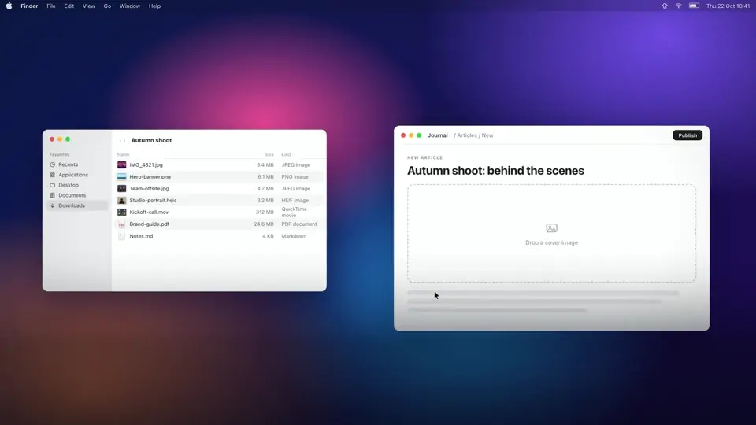

# Shift

Menu bar app for macOS that converts, compresses and resizes files the moment you drag them and hold Shift.
Results stay in a floating shelf, ready to drag into the next tool. Free for macOS.

[](docs/shift-release.mp4)

▶ [Watch the release film](docs/shift-release.mp4) (60 s, with sound). The source lives in [promo/](promo/).

## How it works

1. Drag one or more files anywhere (Finder, desktop, any app that drags real files).
2. Hold **Shift** while dragging (or the keys you set in Settings → General). A bar slides in at the top of the screen (full width, at most 1600 px), under the menu bar,
   with large tiles for the actions that fit what you are dragging.
3. Slide onto a tile and let go: it runs right away. Let go on "Op de shelf" to park the files as they are.
   Let go anywhere else on the bar and it stays open: click a tile or press 1-9 (Return runs the first).
4. Results land in the shelf (top right). Drag them out into Figma, a CMS, Slack, Mail, anything. Double-click opens, the copy button puts the file (and image data) on the clipboard.
   Click a row to select it, then **Space** opens Quick Look, the arrow keys move through the shelf, Delete takes the file off the shelf and ⌘C copies it.

No Accessibility or Input Monitoring permission needed: Shift polls mouse, modifier and drag-pasteboard state.

## Settings

Open Settings from the menu bar icon (⌘,).

- **General**: output folder, copy results to the clipboard, launch at login, and the trigger: any combination of
  ⌃ ⌥ ⇧ ⌘ fn to hold while dragging. Click the keys or press Record and hold the combination.
- **Actions**: per file type, tick the actions that show up in the bar and drag them into your order. The first one is
  the highlighted tile and runs on Return. Actions that would not change a file stay hidden on their own: To JPG for a
  JPG, a resize preset for images that are already small enough, One PDF for a single image.
- **Presets**: your own compression and resize options.
  - Images: crop (trim edges, ratio), format (keep, smallest, or a fixed one), longest side or scale, quality.
    Crop… in the bar replaces the originals by default (they go to the Trash first) or saves new files, can compress in
    the same go, and has a Save as Preset button for numbers you use often.
  - Video: resolution, quality, keep or drop audio. Always H.264 MP4.
  - PDF: image quality and resolution.

The web preset, Compress, 50%, the Max px sizes, Web 1080p/720p and PDF Compress are presets too: edit, duplicate or
delete them. Settings live in the `men.stuur.shift` defaults domain, shared with the CLI.

## Actions

| Files | Actions |
| --- | --- |
| Images | Presets: **Web preset** (WebP, max 2000 px long edge, quality 78), Compress, 50%, max 1920 / 1280 / 640 px. Convert to JPG/PNG/WebP (AVIF, HEIC, TIFF in Settings), **Crop…** (drag the edges on a large preview or type exact pixels, optionally crop to a ratio; the same crop for every image), combine into one PDF, Markdown via OCR. Always sRGB, metadata stripped |
| Text (md, txt, docx, rtf, html, code) | PDF (A4, page numbers, Markdown rendered), Markdown (headings, lists, links, tables), plain text |
| PDF | Compress preset (images to JPEG at 144 dpi), Markdown (paragraphs rebuilt from line positions), pages to PNG or JPG |
| Video | Presets Web 1080p / 720p (H.264 MP4, capped bitrate), MP4, extract audio, Markdown transcript |
| Audio | M4A, Markdown transcript |
| Anything else | Park on the shelf |

Transcripts run on-device (macOS 26). The language is detected by transcribing a 30 second sample in each of
your preferred languages and keeping the most confident one. Dutch goes through DictationTranscriber, which
covers languages SpeechTranscriber does not. The first run per language downloads the speech model.

Compression never ships a bigger file: if the result is larger, the original is kept.
Output goes to `~/Downloads/Shift` (change it from the menu bar icon).

## Install

Download the latest `Shift-x.y.z.dmg` from [Releases](https://github.com/mike-hendriks/shift/releases/latest), open it
and drag Shift to Applications.

Shift is not notarized yet, so macOS blocks the first launch. Open it once, then go to System Settings → Privacy &
Security and click **Open Anyway**. After that Shift starts normally and keeps itself up to date: it checks for updates
daily (Settings → General → Updates, or Check for Updates… in the menu).

## Requirements

- macOS 15 or later (transcription needs macOS 26), Apple Silicon
- To build: Swift 6 toolchain (Command Line Tools are enough). WebP encoding is built in through libwebp.

## Build

```bash
scripts/build-app.sh            # builds dist/Shift.app and dist/shift-cli
scripts/build-app.sh --install  # also copies to /Applications and launches
```

## Releasing

Releases are built by GitHub Actions ([release.yml](.github/workflows/release.yml)) when you push a version tag:

```bash
git tag v0.2.0
git push origin v0.2.0
```

The workflow runs [scripts/release.sh](scripts/release.sh), which builds Shift.app, packs `Shift-0.2.0.dmg`, signs it
with the Sparkle EdDSA key and writes `appcast.xml`. Both are attached to the GitHub release. Installed copies read
`releases/latest/download/appcast.xml`, so every published release reaches all users.

- Build numbers (`CFBundleVersion`, which Sparkle compares) are the commit count, so they always go up.
- Release notes are the commit titles since the previous tag.
- The private signing key lives in your login keychain (Sparkle's `generate_keys`) and in the repository secret
  `SPARKLE_PRIVATE_KEY`. Lose both and existing installs cannot verify new updates anymore, so keep a backup:
  `.build/sparkle-tools/bin/generate_keys -x sparkle-key-backup` and store it in a password manager.
- `scripts/release.sh 0.2.0` builds the same files locally without publishing.

### Code signing

macOS remembers file permissions (Desktop, Documents, Downloads) per app signature. Ad-hoc signatures change with
every build, which made macOS ask again after every update. Builds are therefore signed with one self-signed
certificate, "Shift Code Signing", so the signature stays the same and permissions granted once stay granted.

- CI imports it from the secrets `SIGNING_CERT_P12` (base64) and `SIGNING_CERT_PASSWORD` into a temporary keychain.
- Locally it lives in `~/Library/Keychains/shift-signing.keychain-db`, unlocked with the password in
  `~/.config/shift/signing-keychain-password`. On another Mac: `scripts/setup-signing.sh shift-signing.p12 <password>`.
- Without the certificate, `scripts/build-app.sh` falls back to ad-hoc signing and says so.
- Keep `~/.config/shift/shift-signing.p12` and its password in a password manager. Losing it is not fatal: a new
  certificate only means users grant file access once more.

A self-signed certificate does not satisfy Gatekeeper, so the first launch still needs Open Anyway. With an Apple
Developer ID, set `SIGN_IDENTITY` to the Developer ID Application identity and add notarization
(`xcrun notarytool submit --wait`, then `xcrun stapler staple`) to `scripts/release.sh`; the build script enables the
hardened runtime and a secure timestamp for Developer ID identities.

## CLI

The same engine is available from the terminal:

```bash
dist/shift-cli suggest photo.heic notes.md
dist/shift-cli web --out ~/Desktop/web *.jpg        # "web" is short for preset-web
dist/shift-cli preset-video-720 clip.mov            # any preset id shown by suggest
dist/shift-cli crop --bottom 200 *.png              # also --top, --left, --right, --aspect 16:9, --compress, --overwrite
```

## Layout

- `Sources/ShiftCore` - file detection, suggestions and all processing (ImageIO, libwebp, Vision, Speech, TextKit, PDFKit, AVFoundation)
- `Sources/Shift` - the app: drag watcher, drop panel, shelf, menu bar
- `Sources/ShiftCLI` - command line wrapper around ShiftCore
